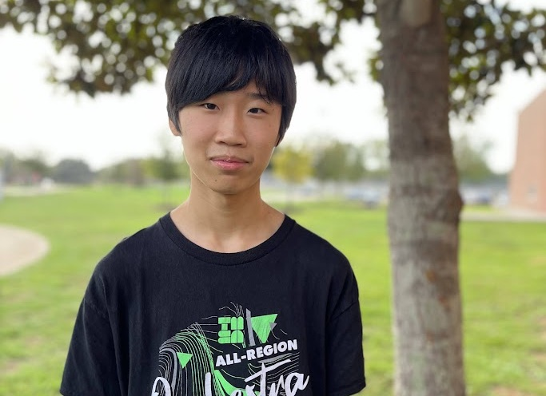

# My Achievements:

## Violin
- Performed at Midwest Chicago (2022)
- Performed at TMEA 2024 as the Middle School Champion
- Performed in Texas Region 13 Middle School Orchestra (2021-2023) 
- Performed in Texas All-Region High School Orchestra (2024, 2025, 2026)

## Engineering
- 2023 Future City Competition - Best Housing Award

## Math
- AMC8 Honor Roll: 2022 19; 2023 20; 2024 21
- AMC10: 2022: 93 2023: 100.5 2024: 96 2025: 99 
- AMC12: 2026: 108, AIME Qualify

## Computer Science
- Dec 2024 Promoted to USACO Silver League
- Oct 2025 UIL computer science contest at Seven Lakes HS, individual rank #9, team rank #10.
- Jan 2026 Promoted to USACO Gold League 
- Jan 2026 UIL computer science contest at Tompkins High School,  individual rank #11, programming (team) rank #2, AHS rank #3.
- Mar 2026 Lockheed Martin Code Quest, Advanced Division, team #3 (AHS Knight) 
- Mar 2026 HPE CodeWars , Advanced Division, team #6 (AHS Knight) 
- Mar 2026 UIL CS District, 3rd place in team competition, 6th place in written test
- Sep 2026 UIL computer science contest at Seven Lakes High School,  individual rank #6, programming (team) rank #3

## Science Olympiad
- Nov 2026 Cypress Falls Invitational Scioly Contest - 1st in Rocket Science C
- Nov 2026 ATX Scioly Invitational - 2nd in Rocket Science C, 2nd in Codebusters C

## Volunteer
- [Best Bridge to Heart](https://bestbridgetoheart.org/): Serving as _Public Relationship Manager_
- [Serena Chamber Music](https://serenamusicgroup.wixsite.com/my-site-1): Violinist